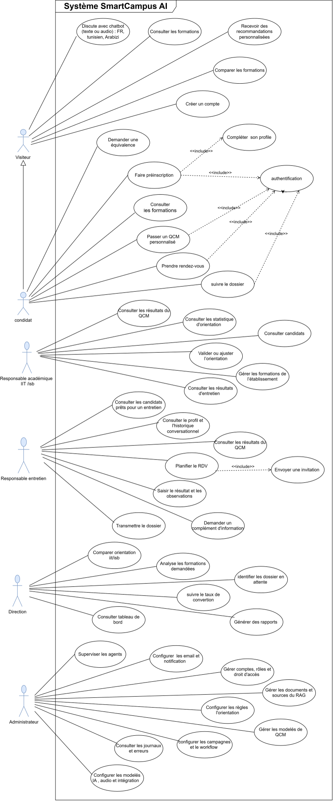

# SmartCampus AI – Analyse des acteurs

## 1. Objectif

Dans cette partie, nous allons identifier les différents acteurs qui utilisent notre plateforme SmartCampus AI et définir leurs rôles ainsi que les fonctionnalités auxquelles ils peuvent accéder.

Cette analyse nous permet de mieux comprendre les besoins de chaque utilisateur et de préciser les responsabilités de chacun dans le processus d'orientation et de préinscription.

Notre objectif est de proposer une plateforme qui accompagne les futurs étudiants dans leur choix de formation, tout en facilitant le travail des responsables de l'IIT et de l'ISB.

## 2. Identification des acteurs

Dans notre conception, nous avons distingué trois grandes catégories d'utilisateurs : le visiteur sans compte, le candidat identifié et les responsables.

Les responsables sont ensuite répartis selon leurs missions au sein de la plateforme.

| Acteur | Rôle principal |
|---|---|
| Visiteur | Découvrir les formations, discuter avec le chatbot et recevoir des recommandations personnalisées sans créer de compte. |
| Candidat | Compléter son profil, effectuer une préinscription, passer un QCM et suivre son dossier. |
| Responsable académique IIT | Vérifier les orientations et gérer les informations des formations de l'IIT. |
| Responsable académique ISB | Vérifier les orientations et gérer les informations des formations de l'ISB. |
| Responsable entretien | Organiser les rendez-vous et réaliser les entretiens avec les candidats. |
| Direction | Suivre les activités de la plateforme et consulter les statistiques. |
| Administrateur | Gérer les utilisateurs, les paramètres et le bon fonctionnement de la plateforme. |

## 3. Description des acteurs

### 3.1. Visiteur

Le visiteur est une personne qui accède à SmartCampus AI sans avoir de compte.

Il peut consulter les formations proposées par l'IIT et l'ISB et discuter avec le chatbot en français, en dialecte tunisien ou en Arabizi, par texte ou par audio.

Pendant la conversation, le chatbot lui pose progressivement des questions sur son parcours scolaire, ses centres d'intérêt, ses matières préférées et ses objectifs professionnels.

À partir de ses réponses, SmartCampus AI lui propose plusieurs formations adaptées à son profil. Le chatbot lui explique également les raisons de ces recommandations et lui permet de comparer les parcours pour l'aider à faire son choix.

Le visiteur peut donc profiter du service d'orientation sans avoir besoin de créer un compte.

En revanche, s'il souhaite commencer une démarche de préinscription ou suivre un dossier personnel, il doit créer un compte candidat.

### 3.2. Candidat

Le candidat est un futur étudiant qui possède un compte sur SmartCampus AI.

Comme le visiteur, il peut discuter avec le chatbot et recevoir des recommandations personnalisées. La différence est qu'il dispose d'un profil enregistré qu'il peut retrouver et compléter.

Il peut renseigner ses informations scolaires, ses centres d'intérêt, ses préférences et ses objectifs afin d'obtenir des recommandations adaptées à son parcours.

Une fois qu'il a choisi une formation, il peut effectuer sa préinscription en complétant les informations demandées par la plateforme.

Si son parcours nécessite une équivalence, nous avons également prévu qu'il puisse déposer une demande accompagnée des documents nécessaires, comme ses diplômes et ses relevés de notes. Cette demande sera ensuite examinée par le responsable académique concerné.

Le candidat peut aussi passer un QCM personnalisé selon la formation choisie. Ce questionnaire permet de mieux connaître ses compétences et de préparer son entretien.

Il peut ensuite choisir un créneau de rendez-vous, consulter les informations concernant son entretien et suivre l'avancement de son dossier.

Tout au long de son parcours, il peut recevoir des confirmations, des notifications et des rappels concernant les différentes étapes de sa candidature.

### 3.3. Responsable académique IIT

Le responsable académique IIT s'occupe des formations proposées par l'IIT et des candidats orientés vers cet établissement.

Il peut consulter les profils des candidats et les recommandations générées par SmartCampus AI afin de vérifier si les formations proposées correspondent réellement à leur parcours.

Si nécessaire, il peut confirmer ou ajuster une recommandation.

Il peut également consulter les résultats des QCM et gérer les informations relatives aux formations de l'IIT, notamment les programmes, les conditions d'accès et les débouchés.

Dans le cas où la fonctionnalité d'équivalence est retenue, il pourra aussi examiner les demandes concernant l'IIT.

Enfin, il peut consulter les statistiques pour suivre les formations les plus demandées et les orientations effectuées vers l'IIT.

### 3.4. Responsable académique ISB

Le responsable académique ISB possède des responsabilités similaires à celles du responsable IIT, mais il intervient uniquement sur les formations et les candidats concernés par l'ISB.

Il peut consulter les profils des candidats, vérifier les recommandations proposées par l'IA et les ajuster si nécessaire.

Il peut également consulter les résultats des QCM, gérer les informations des formations de l'ISB et suivre les statistiques d'orientation.

Si nous intégrons la gestion des équivalences, il pourra examiner les demandes relevant de son établissement.

### 3.5. Responsable entretien

Le responsable entretien intervient lorsqu'un candidat arrive à l'étape de l'entretien.

Il peut consulter son profil, son parcours conversationnel, les formations recommandées et les réponses à son QCM afin de préparer les questions à poser.

La plateforme lui fournit également une synthèse des points importants à approfondir pendant l'entretien.

Il peut définir ou valider les créneaux de rendez-vous et envoyer les invitations aux candidats.

Après l'entretien, il enregistre les résultats et ses observations sur la plateforme.

Si le dossier est incomplet, il peut demander des informations supplémentaires au candidat. Sinon, il transmet le dossier à l'étape suivante.

### 3.6. Direction

La Direction utilise SmartCampus AI pour suivre les activités de la plateforme et avoir une vue d'ensemble sur les candidatures.

À partir d'un tableau de bord, elle peut consulter le nombre de conversations, de recommandations, de préinscriptions, d'entretiens et d'inscriptions.

Elle peut également connaître les formations les plus demandées, comparer les orientations vers l'IIT et l'ISB et suivre l'évolution des candidatures.

La Direction peut aussi identifier les dossiers en attente ou abandonnés et consulter les indicateurs de performance du système IA.

Ces informations lui permettent de mieux suivre les résultats de la plateforme et de prendre des décisions adaptées.

### 3.7. Administrateur

L'administrateur est chargé de la gestion et du bon fonctionnement de SmartCampus AI.

Il s'occupe des comptes utilisateurs, des rôles et des droits d'accès afin que chaque utilisateur puisse accéder uniquement aux fonctionnalités qui le concernent.

Il peut aussi configurer les campagnes d'admission, les règles d'orientation, les modèles de QCM et les notifications.

Il gère les documents et les sources officielles utilisés par le système RAG pour fournir des informations fiables sur les formations de l'IIT et de l'ISB.

L'administrateur supervise également les agents IA, les paramètres des modèles et les différentes intégrations techniques.

Enfin, il peut consulter les journaux et les erreurs pour détecter les problèmes et assurer le bon fonctionnement de la plateforme.

## 4. Relations entre les acteurs

Dans notre plateforme, le visiteur et le candidat partagent certaines fonctionnalités, comme la discussion avec le chatbot, la consultation des formations et les recommandations personnalisées.

La principale différence est que le visiteur utilise ces services sans compte, tandis que le candidat dispose d'un profil enregistré et peut effectuer des démarches de préinscription.

Les responsables académiques IIT et ISB possèdent des fonctionnalités similaires, mais chacun intervient uniquement sur les formations et les candidats de son établissement.

Le responsable entretien prend en charge l'organisation des rendez-vous et le suivi des entretiens.

La Direction utilise principalement la plateforme pour consulter les statistiques et suivre les résultats, tandis que l'administrateur s'occupe des paramètres et du fonctionnement du système.

Chaque acteur a donc un rôle précis dans SmartCampus AI.

## 5. Règles d'accès

Pour bien organiser notre plateforme et protéger les informations des utilisateurs, nous avons défini plusieurs règles :

- Le visiteur peut discuter avec le chatbot, consulter les formations et recevoir des recommandations personnalisées sans créer de compte.
- Le candidat peut enregistrer son profil, effectuer une préinscription, passer un QCM et suivre ses propres dossiers.
- La demande d'équivalence, si elle est intégrée à notre projet, sera réservée aux candidats identifiés.
- Les responsables académiques IIT et ISB peuvent consulter et gérer les informations liées à leur établissement.
- Le responsable entretien accède aux dossiers nécessaires pour organiser et réaliser les entretiens.
- La Direction consulte les statistiques et les informations de suivi autorisées.
- L'administrateur gère les comptes, les paramètres et les droits d'accès de la plateforme.

Les recommandations proposées par SmartCampus AI servent à aider les étudiants dans leur choix. Les décisions officielles restent sous la responsabilité des personnes concernées.

## 6. Diagramme de cas d'utilisation UML

Ce diagramme présente les principales fonctionnalités de SmartCampus AI et montre comment les différents acteurs interagissent avec la plateforme. Il permet de visualiser les services accessibles au visiteur, au candidat et aux responsables.

## 7. Conclusion

Cette analyse nous a permis d'identifier les différents acteurs de SmartCampus AI et de mieux comprendre leurs besoins et leurs responsabilités.

Nous avons distingué les fonctionnalités accessibles aux visiteurs de celles réservées aux candidats ayant un compte.

Notre objectif est de permettre aux futurs étudiants de découvrir les formations et de recevoir une orientation personnalisée dès leur première conversation avec le chatbot, même sans inscription.

Cette analyse nous servira ensuite de base pour réaliser le diagramme de cas d'utilisation UML et définir les processus métier de notre plateforme.
