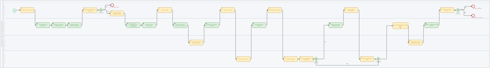

# SmartCampus AI – Processus métier

## 1. Objectif

Dans cette partie, nous présentons les principales étapes du processus d'orientation et de préinscription sur SmartCampus AI, depuis la première conversation avec l'assistant IA jusqu'au suivi du dossier candidat.

## 2. Déroulement du processus

1. **Orientation :** le visiteur discute avec l'assistant IA et reçoit des recommandations de formations adaptées à son profil.
2. **Préinscription :** le visiteur crée un compte candidat et complète les informations nécessaires.
3. **QCM personnalisé :** le système génère un questionnaire adapté au parcours choisi, puis analyse les réponses.
4. **Rendez-vous :** le candidat choisit un créneau et reçoit une confirmation.
5. **Entretien :** le responsable entretien réalise l'entretien et enregistre ses observations.
6. **Suivi :** SmartCampus AI suit le dossier, envoie les rappels autorisés et communique le statut officiel transmis par l'établissement.

## 3. Diagramme BPMN

Le diagramme suivant présente le déroulement du processus et les responsabilités de chaque acteur.

## 4. Conclusion

Ce diagramme nous permet de mieux comprendre l'enchaînement des étapes et les interactions entre les différents acteurs de SmartCampus AI.
